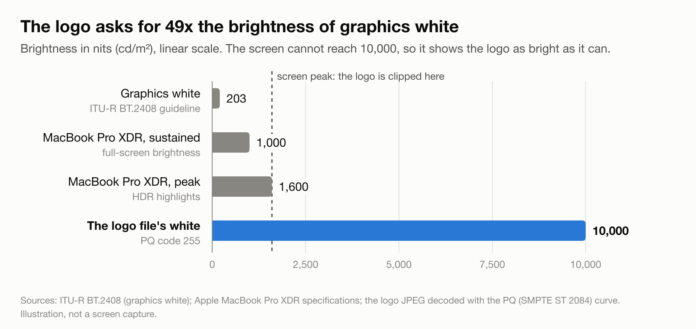
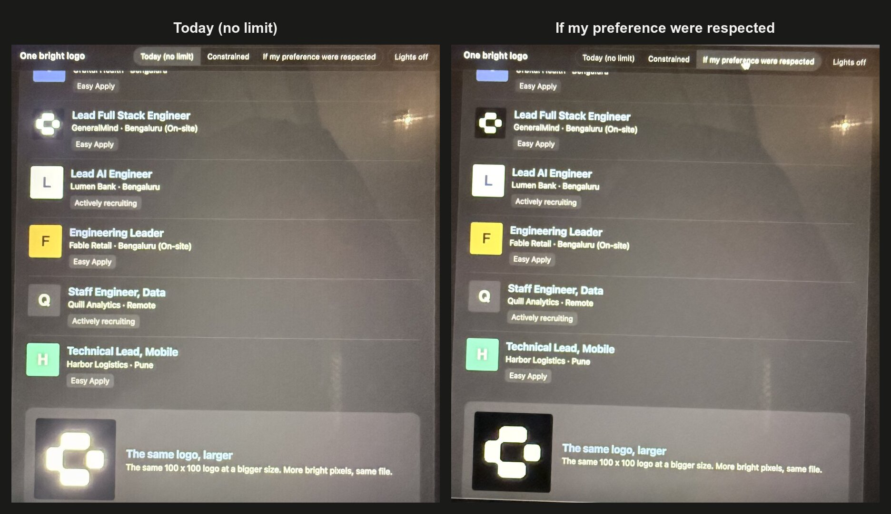

# Explainer: a user preference for limiting HDR brightness

Technical names are kept, and each one is explained the first time it appears.

Author: Prakash Upadhyay  
Discussion: [w3c/csswg-drafts#14616](https://github.com/w3c/csswg-drafts/issues/14616)  
Published: 18 Oct 2026. Feedback welcome: [open an issue](https://github.com/upadhyayprakash/hdr-brightness-a11y/issues).  
Versions: this page (balanced) · [technical](technical.md) · [plain language](plain.md) · [live demo](demo/)  

## Summary

HDR screens can show parts of an image much brighter than normal page white. Developers can cap that brightness with the CSS property `dynamic-range-limit`, but almost nobody does, and users have no way to ask for it. This proposal adds a user preference, in the same family as `prefers-reduced-motion`, so people can say "no sudden brightness spikes" once and have browsers, websites and apps respect it.

## The problem

### HDR and headroom

**HDR** (high dynamic range) screens, such as MacBook Pro XDR displays, recent iPhones and iPads, many OLED phones and HDR monitors, keep extra brightness in reserve above normal white. That reserve is called **HDR headroom** (Apple calls it EDR, Extended Dynamic Range). Ordinary **SDR** (standard dynamic range) content never uses it. An HDR image or video can, and the browser lets it.

### A real example

A 100 x 100 company logo in a LinkedIn job alert, opened in Yahoo Mail in Chrome on a MacBook XDR display, glowed far brighter than the rest of the email.

The JPEG file explains why. It embeds an Apple color profile labelled "Rec. ITU-R BT.2100 PQ". **PQ** (Perceptual Quantizer) is an HDR encoding where each pixel value means an absolute brightness, up to 10,000 **nits** (the unit of screen brightness). The logo's white pixels sit at the very top of that scale: 10,000 nits. The broadcast guideline ITU-R BT.2408 puts white graphics at 203 nits, so the file asks for about 49 times that. The screen clips it at its own maximum, which is still several times brighter than the page around it.



<picture>
  <source media="(prefers-reduced-motion: no-preference)" srcset="figures/photo-blink.gif">
  
</picture>

*Phone photos of the live demo on a MacBook Pro XDR display, same exposure. A screenshot can't show this, a camera can. The animation switches every 1.5 seconds. If you have reduced motion turned on, you see the [two photos side by side](figures/photo-comparison.jpg) instead.*

Nobody meant it to glow. It was most likely exported from an Apple tool with an HDR color space selected. As phones save HDR photos by default, anything users upload (avatars, logos, product photos) can bring HDR onto pages whose developers never chose it.

### Invisible in screenshots

Screenshots are saved in SDR, so anything above normal white is clipped and the page looks normal. The glow never shows up in design reviews, bug reports or Slack threads. You only see it live, on an HDR screen.

### The harm is the jump

The problem is not overall brightness but the **sudden relative jump**: one element far brighter than its surroundings, often while scrolling a dim page at night. It is the visual version of a TV advert much louder than the programme. For people with migraine, photophobia (light sensitivity) or some eye conditions, it can be painful, not just annoying.

## What exists today

| Tool | Type | Who controls it | Why it falls short |
|---|---|---|---|
| `dynamic-range-limit: standard \| constrained \| no-limit` | CSS property ([CSS Color HDR 1](https://drafts.csswg.org/css-color-hdr/)) | Developer | Caps HDR per element, but only if the developer knows about HDR and adds it. Default is `no-limit`. Chrome and Edge 136+, Safari 26+, not Firefox. |
| `@media (dynamic-range: high)` | Media query ([Media Queries 5](https://www.w3.org/TR/mediaqueries-5/)) | Hardware | Tells the page the screen *can* show HDR, not whether the person *wants* it. |
| Reduce White Point | iOS / iPadOS accessibility setting | User | Dims the whole screen, including text. The HDR element stays several times brighter than its surroundings. |
| "Enhanced HDR brightness" | Android setting | User | Seen only in beta builds so far, and not exposed to apps. |
| HDR on/off per display | Windows setting | User | All or nothing. |
| `UIImageView.preferredImageDynamicRange`, SwiftUI `.allowedDynamicRange(_:)`, `CALayer.DynamicRange`, Android `Window.setDesiredHdrHeadroom()` | Native app APIs | App developer | Same as CSS: apps can cap HDR, but nothing tells them what the user prefers. |

A quick note on two terms used above and below:

- A **CSS property** is a styling rule a developer writes, for example `img { dynamic-range-limit: standard; }` ("cap all images at normal white").
- A **media query** lets a page adapt to the device or the user, for example `@media (prefers-reduced-motion: reduce) { ... }` ("if the user asked for less motion, do this").

So today a developer can cap HDR for everyone on an HDR screen, or for no one. They cannot do it just for the people who need it.

### The spec already asks for a user option

The [CSS Color HDR 1 spec, Accessibility Considerations](https://www.w3.org/TR/css-color-hdr-1/#a11y) (W3C Working Draft, 8 October 2026) says:

> "Some individuals may have a sensitivity to very bright colors, so user agents should provide a mechanism to limit the maximum luminance at user option."

("User agent" is the spec term for a browser.) It is a "should", not a "must", and the spec does not define the mechanism. Its only concrete suggestion is a **user stylesheet** (CSS the user adds themselves) setting `dynamic-range-limit` to `standard` or `constrained`. But in CSS, the website's own rules beat a user stylesheet unless the user's rule is marked `!important`, which most people would never know to do. I found no browser that offers such a setting today.

### Usage data

From Chrome Platform Status, which publishes the share of Chrome page loads using each feature (16 Oct 2026):

| Feature | What it does | Share of page loads |
|---|---|---|
| `prefers-reduced-motion` | Respects the user's "reduce motion" setting | 58.3% |
| `prefers-contrast` | Respects the user's contrast setting | 27.2% |
| `dynamic-range` | Checks whether the screen can show HDR | 6.6% |
| `prefers-reduced-transparency` | Respects the user's "reduce transparency" setting | 5.5% |
| `dynamic-range-limit` | Caps HDR brightness | 0.66% |

Pages check whether the screen can show HDR ten times more often than they cap it, and the cap appears on about 1/90th as many page loads as `prefers-reduced-motion`. User preferences clearly work when they exist: the gap is that this one doesn't.

## Who it is for

**Call for use cases.** The CSS Working Group asks for concrete, real-world use cases before it adds a media feature ([#6757](https://github.com/w3c/csswg-drafts/issues/6757)). If sudden HDR brightness affects you, or people you support, please [share your experience in an issue](https://github.com/upadhyayprakash/hdr-brightness-a11y/issues). Groups this is likely to matter for:

- People with migraine, where sudden bright light is a known trigger.
- People with photophobia, including after concussion or eye surgery.
- People with low vision who keep screens bright to read text, so dimming the screen is not an option.
- Anyone reading in a dark room.

## Goals and non-goals

Goals:
- One preference, set once, respected by browsers, websites and apps.
- Protection even on sites whose developers do nothing.
- A way for developers who care to adapt the design, not just the brightness.
- Build on `dynamic-range-limit` rather than invent a new model.

Non-goals:
- Changing how HDR is encoded or measured.
- Replacing OS settings like Reduce White Point or night modes.
- Defining HDR flash thresholds for photosensitive epilepsy (a related gap, see below).

## Proposal

Two parts, strongest together.

### Part 1: a browser or OS override

A setting that forces `dynamic-range-limit` to `standard` (or `constrained`) for all content, at a priority website CSS cannot undo. It protects users everywhere with no developer work. The spec editor suggested this direction in [#11790](https://github.com/w3c/csswg-drafts/issues/11790): "always treat `no-limit` as `constrained-high`".

### Part 2: a media feature developers can read

The same setting exposed as a media query, so developers can redesign for people who asked, for example by showing an SDR poster image instead of an autoplaying HDR video, using an SDR logo, or skipping HDR autoplay.

This mirrors `prefers-reduced-motion`. iOS and macOS already had a system Reduce Motion setting, and the media feature was still added, because the system can slow animations down but only the developer can redesign them.

### Naming: two options, left open

**Option A: levels**

```css
/* The user wants no HDR brightness above normal white */
@media (prefers-dynamic-range: standard) {
  img, video { dynamic-range-limit: standard; }
  .hero-video { display: none; }   /* show the SDR poster instead */
}
```

Values: `standard | constrained | no-preference`.

- Matches the three `dynamic-range-limit` values and Apple's three rendering styles (standard, constrained HDR, full HDR).
- Keeps a middle level. In the demo, at about 50% screen brightness, `constrained` and `standard` look clearly different in Chrome, so the middle level is real.
- Risk: `dynamic-range: standard` (the screen can't do HDR) and `prefers-dynamic-range: standard` (the person doesn't want HDR) differ by one word, and using the wrong one fails silently.
- Precedent: `prefers-contrast: more | less | custom | no-preference`.

**Option B: on/off**

```css
/* The user asked for reduced peak brightness */
@media (prefers-reduced-peak-brightness: reduce) {
  img, video { dynamic-range-limit: standard; }
}
```

Values: `reduce | no-preference`. Alternative name: `prefers-reduced-highlights`.

- Says what gets limited, and reads immediately as an accessibility preference.
- Can't be confused with the hardware query.
- Risk: less familiar wording, no middle level, and "brightness" may invite the reply "just dim your screen".
- Precedent: `prefers-reduced-motion`, `prefers-reduced-transparency`, `prefers-reduced-data`.

## Precedent: loudness normalization in audio

Audio had the same problem (one segment much louder than the rest) and solved it.

| | Audio | HDR screens |
|---|---|---|
| Measure | **LUFS**, a loudness unit based on how loud something *sounds* relative to the programme (ITU-R BS.1770) | Nits and HDR headroom. No agreed measure of how big a brightness jump *feels*. |
| Content standard | EBU R128 (Europe), ATSC A/85 (US) | ITU-R BT.2408 (white graphics at 203 nits), rarely followed outside broadcast |
| Law | US CALM Act (2010): adverts may not be louder than the programme | None |
| Playback normalization | Spotify, Apple Music and YouTube adjust every track | None. Browsers render HDR as the file asks. |
| User preference | Spotify: Loud, Normal, Quiet, or off | None |

Lessons:

1. Normalize by default and let the user pick the level. Spotify's three levels map onto `standard` / `constrained` / `no-limit`.
2. Measure the relative jump, not the absolute level.
3. A content guideline alone doesn't work. The fix has to happen at playback, which on the web means the browser.
4. Turning down the master volume never fixed loud adverts. Normalizing the loud segment did. Reduce White Point is the master volume.

## Objections and answers

**"OS-level dimming is enough."** (Raised by a WebKit engineer in #11790.) For rendering alone, a browser or OS cap is indeed the best protection, which is why Part 1 exists. But dimming alone falls short:

- It dims everything. The jump is a ratio, so an HDR logo stays several times brighter than the page while text gets harder to read.
- It isn't everywhere. Reduce White Point is on iPhone and iPad. I found no equivalent on Mac, Android has a beta toggle, and Windows has only on/off.
- An OS can't change design decisions. Only the developer can swap an HDR video for a still image, and only if they know the user's preference.

**"We already have `dynamic-range`."** That query describes the hardware. It matches on an HDR laptop whether the owner loves HDR or gets headaches from it. Motion works the same way: the hardware decides if animation is possible, and `prefers-reduced-motion` says whether the person wants it.

**Fingerprinting** (sites using small device details to tell users apart). Every `prefers-*` feature adds a little of this. `prefers-reduced-motion`, `prefers-contrast` and `prefers-reduced-transparency` shipped anyway. If the feature only matches on HDR screens (open question 4), it adds nothing on SDR screens.

## Demo

The [live demo](demo/) recreates the inbox with the real logo. A toolbar switches between "Today (no limit)", "Constrained" and "If my preference were respected", and three side-by-side tiles show the same pixels as normal white, full HDR and capped. Needs an HDR screen and Chrome, Edge 136+ or Safari 26+. Screen recordings won't capture the difference.

## Related work

- [csswg-drafts #11790](https://github.com/w3c/csswg-drafts/issues/11790): how a user-level brightness limit should fit the CSS cascade. Open, unresolved.
- [csswg-drafts #8651](https://github.com/w3c/csswg-drafts/issues/8651): `prefers-reduced-strobing`, a stalled photosensitivity preference.
- [WCAG 2.3.1](https://www.w3.org/WAI/WCAG22/Understanding/three-flashes-or-below-threshold.html): the accessibility rule for flashing content measures brightness assuming SDR white is the maximum. It says nothing about content far above that. A separate gap worth raising with WCAG 3.

## Open questions

1. Option A, Option B, or another name?
2. Should the override default to `standard` or `constrained`?
3. Video in scope from the start, or images first?
4. Should the media feature only match on HDR-capable screens?

## Sources

See the [sources in the technical version](technical.md#sources).
